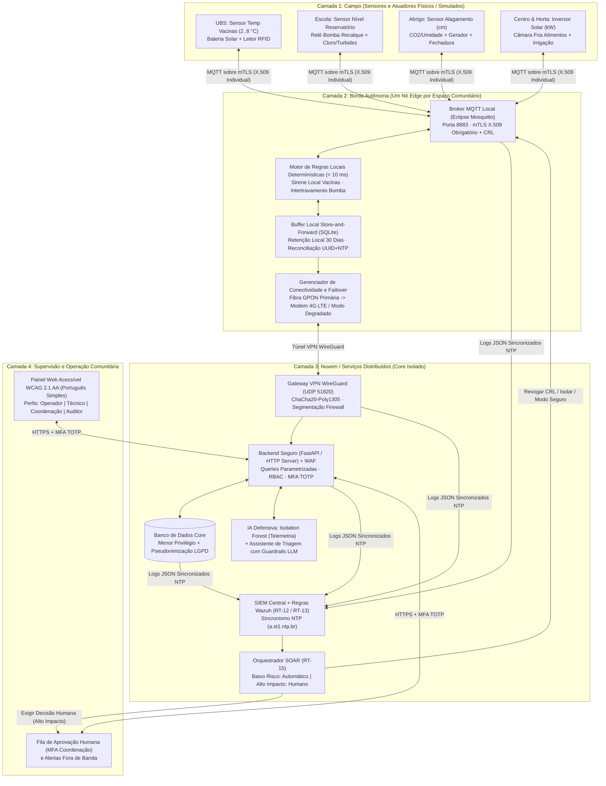

# E1 — Documento de Arquitetura, Modelo de Ameaças, Redundância e Viabilidade
**FIAP · Global Solution 2026.2 · Resilient Community Infrastructure · Turma: 4ECR**  
**Projeto:** Rede Comunitária Vila Aurora (Município Fictício de Serra Clara - SP)  
**Professor:** Prof. Carlos Eduardo de Siqueira  
**Integrantes:** Felipe Henrique de Oliveira Cruz (RM 552566) · Octhor Festa (RM 552533)  
**Repositório Git (E2):** https://github.com/Felipehoc/global_solutions_Resilient_Community_Infrastructure

---

## 1. Visão Geral e Arquitetura em 4 Camadas (RT-01)

A arquitetura da **Rede Comunitária Vila Aurora** foi redesenhada após o incidente **INC-VA-0712** adotando o paradigma **Offline-First (Borda Autônoma)** aliado a **Zero Trust Network Architecture (ZTNA)**. O sistema é estruturado em **quatro camadas desacopladas** que atendem aos cinco espaços comunitários (**Unidade Básica de Saúde - UBS**, **Escola Municipal**, **Abrigo de Emergência da Defesa Civil**, **Centro Comunitário** e **Horta e Cozinha Solidária**):

---

## 2. Operação Local em Falha de Conectividade e Store-and-Forward (RT-02)

Para eliminar a falha crítica evidenciada no incidente `INC-VA-0712` (onde a queda da fibra impediu o envio de alertas de temperatura da câmara fria da UBS), cada espaço comunitário possui um **Nó de Borda Autônomo** (`src/edge_node/autonomous_agent.py`) composto por:

1. **Broker MQTT Local (`mosquitto-edge`):** Opera dentro da LAN de cada espaço comunitário. Os sensores publicam e os atuadores subscrevem localmente, sem depender de DNS externo ou roteamento para a internet.
2. **Motor de Regras de Controle Locais:** Avalia cada leitura em menos de 10 ms diretamente na borda:
   - **Regra Crítica UBS (`EDGE_RULE_UBS_VACCINE_TEMP`):** Se a temperatura da câmara fria sair do intervalo `[2,0 °C .. 8,0 °C]`, aciona imediatamente a sirene sonora/visual local no posto de saúde e liga o relé do compressor reserva, mesmo com 0% de internet.
   - **Regra Crítica Escola (`EDGE_RULE_SCHOOL_PUMP_INTERLOCK`):** Trava fisicamente o relé da bomba de água caso o nível do reservatório caia abaixo de `20%` ou caso um comando de drenagem/acionamento contínuo seja recebido durante a madrugada (`00h00–05h00`), impedindo o esvaziamento malicioso ocorrido no `INC-VA-0712`.
   - **Regra Crítica Abrigo (`EDGE_RULE_SHELTER_FLOOD`):** Se o sensor de lâmina d'água ultrapassar `5,0 cm`, aciona a bomba de drenagem local e destrava o acesso de emergência da Defesa Civil.
3. **Buffer *Store-and-Forward* e Reconciliação Idempotente:**
   - Todas as leituras recebidas durante a indisponibilidade da WAN são gravadas em banco SQLite local (`telemetry_buffer`) com `synced_to_cloud = 0`, `event_id` (UUID v4 único) e `timestamp_ntp` (UTC sincronizado).
   - Quando o link retorna, o método `synchronize_pending_buffer()` envia os lotes ordenados cronologicamente (`ORDER BY timestamp_ntp ASC`). O backend aplica `INSERT OR REPLACE` baseado na chave primária `event_id`, garantindo **0,00% de perda de dados** e zero duplicação em caso de retransmissão.

---

## 3. Plano de Redundância Proporcional e Justificativa de Trade-offs (RT-03)

Em conformidade com o requisito **RT-03** e com o orçamento restrito da associação de moradores, aplicamos **Redundância Proporcional ao Risco à Vida e à Missão Crítica**:

| Espaço Comunitário | Criticidade | Link Primário | Redundância de Conectividade / Modo de Falha | Justificativa Técnica e Financeira (Trade-off RT-03) |
| :--- | :---: | :--- | :--- | :--- |
| **1. Unidade Básica de Saúde (UBS)** | **Muito Alta (Saúde/Vidas)** | Fibra Comunitária GPON | **Modem 4G LTE Dual-SIM** (Failover automático em 4s) + Borda Autônoma + Nobreak Solar 72h | Perda de lotes de vacinas custa dezenas de milhares de reais e afeta a saúde pública; o custo mensal de um chip 4G M2M (~R$ 35/mês) é amplamente justificado. |
| **2. Abrigo de Emergência (Defesa Civil)** | **Muito Alta (Desastres)** | Fibra Comunitária GPON | **Modem 4G LTE Defesa Civil** + Borda Autônoma + Gerador/Bateria | Temporais derrubam a fibra aérea justamente quando o abrigo é ativado; comunicação externa com a Defesa Civil é indispensável. |
| **3. Escola Municipal** | **Média-Alta** | Fibra Comunitária GPON | **Sem Link 4G (Modo Degradado Local *Store-and-Forward*)** | **Justificativa de Não-Redundância WAN:** A segurança física do reservatório e da bomba é 100% garantida pelo intertravamento local no Nó de Borda. Contratar link 4G para a escola aumentaria o OPEX sem ganho de segurança física, pois os dados históricos são sincronizados assim que a fibra volta. |
| **4. Centro Comunitário** | **Média** | Fibra Comunitária GPON | **Sem Link 4G (Modo Degradado Local *Store-and-Forward*)** | **Justificativa de Não-Redundância WAN:** Espaço de uso diurno administrativo; o buffer local SQLite suporta mais de 30 dias offline sem perda de telemetria solar. |
| **5. Horta e Cozinha Solidária** | **Média** | Fibra Comunitária GPON | **Sem Link 4G (Modo Degradado Local *Store-and-Forward*)** | **Justificativa de Não-Redundância WAN:** A câmara fria de alimentos possui alarme sonoro local autônomo na borda; não há justificativa econômica para link celular dedicado nem cluster em múltiplas regiões de nuvem. |

---

## 4. Modelagem Formal de Ameaças — STRIDE e Rastreabilidade ao `INC-VA-0712` (Diferencial)

Mapeamos cada falha explorada no incidente **INC-VA-0712** utilizando a metodologia **STRIDE** até os controles técnicos implementados:

| Etapa do `INC-VA-0712` | Categoria STRIDE | Falha Explorada no Legado | Controle Implementado na Nova Arquitetura | Requisito |
| :--- | :--- | :--- | :--- | :--- |
| **1. E-mail de phishing gerado por IA + áudio de WhatsApp com voz clonada** | **S**poofing (Falsificação de Identidade) | Ausência de autenticação de e-mail e falta de verificação fora de banda para pedidos urgentes. | Registros DNS **SPF (`-all`), DKIM (RSA-2048) e DMARC (`p=quarantine`)** + Protocolo de **Verificação Fora de Banda** e **Palavra-Código Semanal** contra deepfake de voz. | `RT-10`, `RT-11`, `RT-18` |
| **2. Coleta de senha e login na VPN legada às 02h14 sem MFA** | **S**poofing / **E**levation of Privilege | VPN autenticada apenas por senha estática, sem MFA e sem restrição contextual. | **VPN WireGuard** com chaves curvas modernas + **MFA TOTP obrigatório** (`pyotp` RFC 6238) + Regra SIEM **RT-13a** que detecta login anômalo e derruba a sessão via SOAR. | `RT-06`, `RT-09`, `RT-13a`, `RT-15` |
| **3. Exploração de SQL Injection no campo de busca do histórico** | **T**ampering / **I**nformation Disclosure | Concatenação direta de strings SQL, usuário de banco superprivilegiado e erros verbosos. | **Queries 100% parametrizadas (`?`)**, validação allowlist no servidor, **View de menor privilégio** (`v_public_access_history`), erro genérico e **WAF** ativo. | `RT-08`, `RT-13b` |
| **4. Extração de dados de voluntários e alteração da bomba d'água** | **I**nformation Disclosure / **T**ampering | Dados pessoais em texto claro no banco e atuador aceitando comandos irrestritos na madrugada. | **Pseudonimização LGPD** (`HMAC-SHA256`) dos registros de acesso + Intertravamento local na borda bloqueando drenagem de madrugada + **Aprovação Humana (RT-15)**. | `RT-02`, `RT-13d`, `RT-15`, `RT-19` |
| **5. Queda da fibra e perda de alertas da câmara fria de vacinas da UBS** | **D**enial of Service (Indisponibilidade) | Dependência total da nuvem para processar regras de alarme e ausência de link backup na UBS. | **Nó de Borda Autônomo** com alarme local imediato + Buffer SQLite *store-and-forward* + **Failover automático 4G LTE** na UBS e no Abrigo. | `RT-01`, `RT-02`, `RT-03`, `RT-23` |
| **6. Logs espalhados, relógios dessincronizados e sobrescritos** | **R**epudiation (Repúdio) | Ausência de NTP, coleta centralizada e preservação de integridade forense. | Sincronismo **NTP (`a.st1.ntp.br`)** em todas as camadas, envio centralizado ao **SIEM**, retenção de 90/365 dias e coleta forense com **SHA-256** e cadeia de custódia. | `RT-12`, `RT-14` |
| **7. Dispositivo IoT falso ou clonado na rede de campo** | **S**poofing / **T**ampering | Uso de senha compartilhada ou MQTT sem TLS entre sensores. | **Certificado X.509 único por dispositivo** emitido pela `VilaAurora-Root-CA`, **mTLS obrigatório** na porta 8883 e verificação de **CRL (`crl.pem`)**. | `RT-04`, `RT-05`, `RT-13c` |

---

## 5. Identidade, PKI, VPN WireGuard e Segmentação Zero Trust (RT-04 a RT-07, RT-09)

1. **PKI Própria e Certificados X.509 Individuais (`RT-04`):** O módulo `src/pki/pki_manager.py` provisiona a `VilaAurora-Root-CA` e emite 12 certificados X.509 exclusivos (um para cada sensor/atuador dos 5 espaços, ex.: `CN=ubs-camara-fria-01.iot.vilaaurora.org.br`). É estritamente proibido o uso de senha ou certificado compartilhado.
2. **Revogação via CRL e Rotação (`RT-05`):** Quando um dispositivo é comprometido (ex.: `sensor-comprometido-99`), seu número de série é incluído na Lista de Revogação (`certs/crl.pem`) lida pelo Mosquitto (`crlfile`), bloqueando imediatamente o handshake mTLS. O método `rotate_device_certificate()` automatiza a substituição periódica sem downtime.
3. **VPN Moderna e Zero Portas Administrativas Expostas (`RT-06`):** A interconexão Borda ↔ Nuvem ocorre via **WireGuard** (`configs/wireguard/wg0-edge.conf` e `wg0-cloud.conf`). Nenhuma porta administrativa (SSH 22, PostgreSQL 5432, Mosquitto 8883, Painel 8080) fica exposta na interface WAN pública.
4. **Segmentação de Rede e Menor Privilégio (`RT-07`):** O `docker-compose.yml` e o script `configs/wireguard/firewall_rules.sh` isolam o tráfego em 5 sub-redes distintas:
   - `net_iot_field (172.28.10.0/24)`: Sensores falam **apenas** com o Broker MQTT na porta TCP `8883`. Qualquer tentativa de conexão lateral para o banco ou internet sofre `DROP` e gera log `[FW-BLOCK-IOT-LATERAL]`.
   - `net_edge_autonomy (172.28.20.0/24)`: Comunicação restrita entre o Broker Mosquitto e o Agente de Borda local.
   - `net_vpn_tunnel (10.200.0.0/24)`: Túnel criptografado entre os 5 nós de borda e o gateway central.
   - `net_cloud_core (172.28.30.0/24)`: Rede interna do banco de dados, motor de IA e SIEM.
   - `net_supervision (172.28.40.0/24)`: Operadores autenticados com MFA acessam exclusivamente a porta HTTPS do Painel Web.

---

## 6. Privacidade desde a Concepção (LGPD) e RIPD Simplificado (RT-19)

### 6.1 Controles de Privacidade Implementados (`src/backend/privacy.py`)
- **Uso Exclusivo de Dados Sintéticos:** Todos os 5 registros de operadores/voluntários (`VOL-SINT-001` a `VOL-SINT-005`) e leituras de crachá são fictícios.
- **Minimização de Dados:** O sistema coleta apenas o carimbo de tempo, o espaço comunitário, a porta acessada e o perfil funcional, sem armazenar CPF, endereço, telefone ou foto dos voluntários.
- **Pseudonimização Criptográfica:** Antes de gravar qualquer evento de acesso físico na tabela `access_logs`, o identificador bruto do crachá RFID passa por `HMAC-SHA256` com *salt* segregado, gerando um token irreversível (ex.: `PSEUDO-7A91C4E2B019F83D`).

### 6.2 Relatório de Impacto à Proteção de Dados Pessoais — RIPD Simplificado (RT-19)

| Seção do RIPD | Descrição Aplicada à Rede Comunitária Vila Aurora |
| :--- | :--- |
| **1. Agentes de Tratamento** | **Controlador:** Associação Comunitária Vila Aurora (Serra Clara - SP). **Encarregado (DPO):** Comitê de Governança e Auditoria Comunitária (`auditor04.sintetico@vilaaurora.org.br`). |
| **2. Natureza e Finalidade do Tratamento** | Registro de acesso eletrônico às áreas críticas (Sala de Vacinas da UBS, Casa de Bombas da Escola e Depósito da Defesa Civil) exclusivamente para segurança patrimonial, sanitária e investigação de incidentes. |
| **3. Base Legal (Lei nº 13.709/2018 - LGPD)** | **Art. 7º, II** (Cumprimento de obrigação legal/regulatória de vigilância sanitária na conservação de vacinas) e **Art. 7º, IX** (Legítimo interesse na proteção física de infraestrutura crítica comunitária). |
| **4. Categorias de Dados e Minimização** | Apenas código de crachá pseudonimizado (`PSEUDO-...`), perfil RBAC, porta e timestamp UTC. **Não há coleta de dados sensíveis (Art. 5º, II) nem biometria.** |
| **5. Prazo de Retenção e Descarte** | **90 dias** em armazenamento ativo (banco operacional) e **365 dias** em arquivo frio criptografado para fins de auditoria forense, com expurgo automatizado após 12 meses. |
| **6. Medidas de Segurança e Mitigação de Riscos** | Pseudonimização `HMAC-SHA256`, criptografia em trânsito (`mTLS` e `WireGuard`), controle de acesso RBAC com MFA, visão de banco com privilégio mínimo e logs imutáveis. **Risco Residual:** **Baixo**, pois mesmo em caso de vazamento da tabela `access_logs`, os tokens pseudonimizados não permitem reidentificar pessoas naturais sem o *salt* custodiado em cofre isolado. |

---

## 7. Estimativa de Custos (12 Meses) e Plano de Manutenção (RT-20)

### 7.1 Orçamento Realista de Implantação (CAPEX) e Operação por 12 Meses (OPEX)
Pensado para a realidade financeira de uma associação comunitária em parceria com a prefeitura, utilizando **100% de software livre/gratuito** (Linux, Docker, Mosquitto, Python, PostgreSQL/SQLite, WireGuard, Wazuh):

| Categoria | Item | Qtd. | Custo Unitário (R$) | Total CAPEX (Implantação) | Total OPEX (12 Meses) |
| :--- | :--- | :---: | :---: | :---: | :---: |
| **Hardware de Borda (CAPEX)** | Mini-PC / Raspberry Pi 4B (4 GB RAM + Fonte Industrial + Case + SD Endurance 64 GB) — 1 por espaço | 5 un. | R$ 680,00 | R$ 3.400,00 | R$ 0,00 |
| **Redundância 4G (CAPEX)** | Modem Roteador 4G LTE Industrial (apenas para UBS e Abrigo - RT-03) | 2 un. | R$ 420,00 | R$ 840,00 | R$ 0,00 |
| **Sensores e Relés (CAPEX)** | Kit Sensores (DS18B20 à prova d'água, ultrassônico JSN-SR04T, relé optoacoplado, leitor RFID RC522, ESP32) | 5 kits | R$ 290,00 | R$ 1.450,00 | R$ 0,00 |
| **Energia Reserva (CAPEX)** | Mini-Nobreak DC 12V/5V com bateria LiFePO4 para manter o nó Edge ligado por até 72h | 5 un. | R$ 310,00 | R$ 1.550,00 | R$ 0,00 |
| **Conectividade 4G (OPEX)** | Plano de Dados M2M Dual-SIM 5 GB/mês para failover na UBS e Abrigo (2 × R$ 35,00/mês) | 12 meses | R$ 70,00/mês | R$ 0,00 | R$ 840,00 |
| **Nuvem Core / VPS (OPEX)** | VPS Comunitária Nacional (4 vCPU, 8 GB RAM, 160 GB SSD NVMe para Backend/SIEM) | 12 meses | R$ 110,00/mês | R$ 0,00 | R$ 1.320,00 |
| **Domínio & DNS (OPEX)** | Registro anual do domínio `.org.br` (Registro.br) | 1 ano | R$ 40,00/ano | R$ 0,00 | R$ 40,00 |
| **Software e Licenças** | Stack 100% Open Source (Linux, Mosquitto, WireGuard, FastAPI, SQLite/PostgreSQL, Wazuh) | — | R$ 0,00 | R$ 0,00 | R$ 0,00 |
| **Fundo de Manutenção** | Reserva para substituição preventiva de sensores/cabos (OPEX anual) | 1 ano | R$ 600,00/ano | R$ 0,00 | R$ 600,00 |
| **TOTAL GERAL (12 Meses)** | **Implantação (R$ 7.240,00) + Operação 12 Meses (R$ 2.800,00)** | — | — | **R$ 7.240,00** | **R$ 2.800,00** |

> **Custo Total de Propriedade (TCO 1º Ano): R$ 10.040,00** (média de apenas **R$ 46,67/mês por espaço comunitário** após a implantação).

### 7.2 Plano de Manutenção Preventiva, OTA Assinado e Responsáveis (RT-20)

| Atividade de Manutenção | Periodicidade | Procedimento Simplificado e Automatizado | Responsável Designado |
| :--- | :---: | :--- | :--- |
| **1. Atualização Segura de Firmware (OTA Assinado - Diferencial)** | Trimestral ou Correção Crítica | O pacote de atualização é assinado com a chave privada da `VilaAurora-Root-CA` (`SHA-256`). O nó de borda verifica a assinatura digital antes de aplicar e mantém partição de *rollback* automático se o *healthcheck* falhar. | **Técnico de Manutenção (`tecnico02`)** |
| **2. Renovação e Rotação de Certificados X.509 (`RT-05`)** | Semestral (Automatizada aos 330 dias) | Execução automática via cron do script `pki_manager.rotate_device_certificate()`, atualizando a `crl.pem` no Broker Mosquitto sem interromper a operação local. | **Técnico de Manutenção (`tecnico02`)** + Automação PKI |
| **3. Backups Criptografados e Teste de Restauração** | Diário (Incremental) / Mensal (Teste Restore) | Dump diário às 03h00 UTC do banco de dados e configurações (`configs/`, `certs/pki_registry.json`), criptografado com `AES-256-GCM` e replicado entre o servidor Core e o armazenamento local do Centro Comunitário. | **Coordenação (`coordenacao03`)** |
| **4. Revisão de Acessos RBAC e Reciclagem Anti-Phishing** | Trimestral | Revisão da lista de voluntários ativos, revogação imediata de crachás de ex-voluntários, rotação da **Palavra-Código Semanal** e oficina rápida de 15 minutos contra golpes por IA. | **Coordenação (`coordenacao03`)** + **Auditor (`auditor04`)** |
| **5. Teste de Failover 4G e Sirene Local da UBS** | Mensal | Simulação agendada de 5 minutos desconectando o cabo de fibra da UBS para validar o disparo da sirene local e o envio de alerta via modem 4G. | **Operador Local (`operador01`)** |
